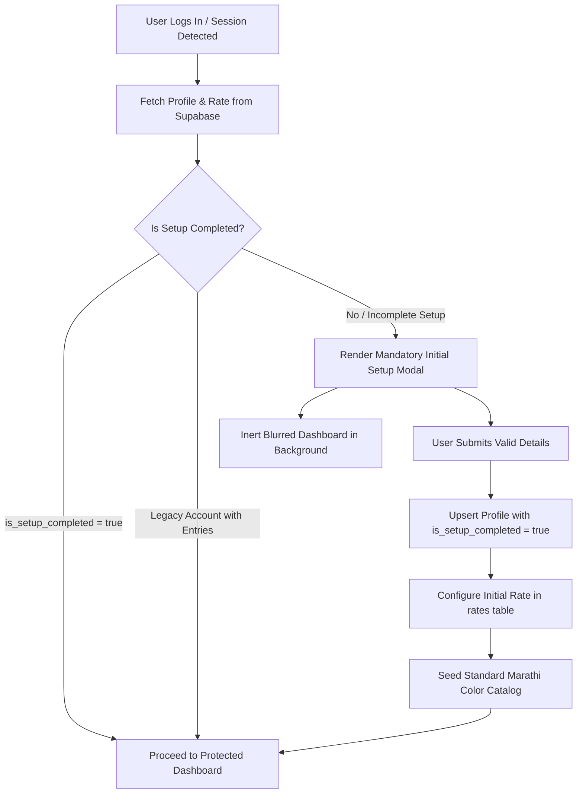

# FallTrack — Mandatory Initial Setup Feature Documentation

This document provides a comprehensive technical and functional overview of the **Mandatory First-Time System Setup** feature implemented in **FallTrack**.

---

## 📌 1. Objective & Background

Prior to this feature, newly registered users entered the system with generic placeholder credentials (such as default manager name, placeholder phone, and a fallback rate of ₹5.00/dozen) and had to manually navigate to Settings to customize them.

### Goals of the Feature:
1. **Mandatory First-Time Onboarding:** Automatically prompt newly registered accounts with a configuration modal upon first login.
2. **Multi-Tenant Data Integrity:** Prevent new users from saving production entries under placeholder settings.
3. **Database-Backed Verification:** Maintain an explicit setup completion flag (`is_setup_completed`) in the database rather than relying on browser `localStorage`.
4. **Backward Compatibility:** Ensure existing active accounts with historical production logs are not locked out or forced to re-configure their workspaces.
5. **Strict Input Standards:** Enforce strict validation (10-digit Indian mobile format, positive rate limits, clean manager names).

---

## 🏛️ 2. Architectural Design & Detection Flow



### Detection Logic (`settingsService.getUserSettings`):
1. **Explicit Flag Check:** Checks `profile.is_setup_completed === true`.
2. **Backward-Compatibility Heuristics:**
   - If `is_setup_completed` is missing or null, checks if the account already has historical entries in `production_entries` or `rates`.
   - If historical production records exist, the account is recognized as an existing active account and auto-migrated to `is_setup_completed = true`.
3. **Flash Prevention:** In [`src/App.tsx`](file:///d:/FallTrack%20Web%20Copy/src/App.tsx), while the status is being fetched from Supabase, a branded pulse loader is shown so unconfigured dashboards never flash on screen.

---

## 🎨 3. UI/UX Specifications

### 1. Blurred Dashboard Background
- When setup is incomplete, the real [`Layout`](file:///d:/FallTrack%20Web%20Copy/src/components/Layout.tsx) and [`Dashboard`](file:///d:/FallTrack%20Web%20Copy/src/pages/Dashboard.tsx) are rendered in the background with:
  ```css
  filter: blur(12px);
  opacity: 0.60;
  transform: scale(1.05);
  pointer-events: none;
  user-select: none;
  ```
- Attributes `aria-hidden="true"` and `tabIndex={-1}` guarantee screen readers and keyboard navigation cannot interact with background elements.
- The modal overlay uses a frosted glass effect (`bg-slate-950/40 backdrop-blur-[2px]`) allowing the underlying dashboard layout to show through subtly.

### 2. Focus Trap & Dismissal Restrictions
- **No Outside Click:** Clicking on the backdrop does not close the modal.
- **No Escape Key:** The `Escape` key event is intercepted (`e.preventDefault()`, `e.stopPropagation()`).
- **Focus Trapping:** Keyboard `Tab` cycles strictly between inputs and the submit button within the modal.
- **Account Identification & Sign Out:** An account badge displaying the authenticated username/email is shown directly above the "Sign out" action in the header, removing ambiguity about which user is currently being configured.

---

## 📋 4. Form Fields & Validation Rules

| Field | Requirement | Validation Rule | Error Message |
| :--- | :--- | :--- | :--- |
| **Manager Name** | Required | Non-empty trimmed string, min 2 characters. | *"Manager name is required."* / *"Manager name must be at least 2 characters."* |
| **Mobile Number** | Required | Exactly 10 digits starting with `6, 7, 8, 9` (`/^[6-9]\d{9}$/`). | *"Mobile number must be exactly 10 digits."* / *"Enter a valid Indian mobile number starting with 6, 7, 8, or 9."* |
| **Rate per Dozen** | Required | Positive numeric amount > ₹0.00 and ≤ ₹10,000.00. | *"Rate must be a positive amount greater than 0."* |

### Input Sanitization:
- **Mobile Number Input:**
  - Non-digit keystrokes are blocked on `onKeyDown` (only numeric keys, arrows, Backspace, Delete, and shortcuts are permitted).
  - Paste operations strip prefixes (`+91`, `0`), spaces, and hyphens automatically, capping at 10 digits.
  - Suffix and prefix containers use `shrink-0` and `whitespace-nowrap` to prevent line breaks.
- **Dynamic Business Formula Preview:**
  - As the user adjusts the rate per dozen, an inline live formula demonstrates the income calculation:
    $$\text{Income} = \left(\frac{\text{Falls}}{12}\right) \times \text{Rate per Dozen}$$

---

## 🗄️ 5. Supabase Persistence & Database Schema

### Database Migration: [`supabase_mandatory_setup.sql`](file:///d:/FallTrack%20Web%20Copy/supabase_mandatory_setup.sql)

```sql
-- 1. Add is_setup_completed flag to profile table
ALTER TABLE public.profile 
ADD COLUMN IF NOT EXISTS is_setup_completed BOOLEAN NOT NULL DEFAULT false;

-- 2. Backfill existing active accounts with historical production logs
UPDATE public.profile p
SET is_setup_completed = true
WHERE p.is_setup_completed = false
  AND (
    EXISTS (SELECT 1 FROM public.production_entries e WHERE e.user_id = p.user_id)
    OR EXISTS (SELECT 1 FROM public.rates r WHERE r.user_id = p.user_id)
    OR (p.manager_name IS NOT NULL AND p.manager_name NOT IN ('Manager', 'Admin', ''))
  );

-- 3. Row Level Security Policy Check
ALTER TABLE public.profile ENABLE ROW LEVEL SECURITY;

DROP POLICY IF EXISTS "Users can view and manage their own profile" ON public.profile;
CREATE POLICY "Users can view and manage their own profile"
ON public.profile FOR ALL
USING (auth.uid() = user_id)
WITH CHECK (auth.uid() = user_id);
```

### Save Sequence (`saveInitialSetup`):
1. **Profile Upsert:** Saves `manager_name`, `manager_phone`, `app_name: 'FallTrack'`, and `is_setup_completed: true` mapped to `auth.uid()`.
2. **Rate Card Insertion:** Inserts an initial rate record in `rates` effective from the current date.
3. **Color Master Seeding:** If the user has 0 colors in `colors`, automatically seeds standard Marathi colors (`राणी`, `लाल`, `पांढरा`, `केशरी`, `निळा`, etc.).

---

## 📁 6. File Changes Summary

| File Path | Description of Changes |
| :--- | :--- |
| [`src/types/index.ts`](file:///d:/FallTrack%20Web%20Copy/src/types/index.ts) | Added `is_setup_completed` to `UserProfile` and declared `InitialSetupData` interface. |
| [`src/services/settingsService.ts`](file:///d:/FallTrack%20Web%20Copy/src/services/settingsService.ts) | Implemented `getUserSettings`, `saveInitialSetup`, `normalizeIndianMobile`, and `isValidIndianMobile`. |
| [`src/store/useSettingsStore.ts`](file:///d:/FallTrack%20Web%20Copy/src/store/useSettingsStore.ts) | Added Zustand store to manage `isSetupCompleted`, `profile`, `isLoading`, and `completeSetup`. |
| [`src/components/InitialSetupModal.tsx`](file:///d:/FallTrack%20Web%20Copy/src/components/InitialSetupModal.tsx) | Modal UI component with focus-trap, digit-only inputs, layout-locked suffixes, and reactive live formula. |
| [`src/App.tsx`](file:///d:/FallTrack%20Web%20Copy/src/App.tsx) | Routed mandatory setup state with blurred dashboard background, preventing unconfigured access. |
| [`supabase_mandatory_setup.sql`](file:///d:/FallTrack%20Web%20Copy/supabase_mandatory_setup.sql) | SQL script adding `is_setup_completed`, RLS security, and backward-compatible backfill. |
| [`supabase/tests/setup/setup-test-runner.js`](file:///d:/FallTrack%20Web%20Copy/supabase/tests/setup/setup-test-runner.js) | Automated test suite verifying validation, backward compatibility, isolation, and dozen formula. |

---

## 🧪 7. Automated & Manual Testing

### Automated Test Suite
Run the test suite using:
```bash
node supabase/tests/setup/setup-test-runner.js
```
**Test Coverage (14/14 Passing):**
- **Group 1:** Indian mobile number format validation and normalization.
- **Group 2:** Manager name trimming and length validation.
- **Group 3:** Positive rate validation and upper bounds.
- **Group 4:** First-login detection and legacy user backward compatibility.
- **Group 5:** Multi-tenant setup isolation (User A vs User B).
- **Group 6:** Mathematical accuracy of the `(Falls / 12) * Rate` dozen formula.

### Manual Verification Checklist
- [x] Register a new user: Modal displays automatically.
- [x] Incomplete setup: Refreshing or typing direct paths keeps the modal open.
- [x] Background blur: Dashboard KPI cards and charts are blurred behind the modal.
- [x] Input restrictions: Typing alphabets in mobile number field is completely blocked.
- [x] Suffix stability: `/ dozen` remains on a single line without wrapping.
- [x] Successful submit: Transitions directly to active Dashboard without reload.
- [x] Settings page: Manager name, mobile number, and rate per dozen remain editable later.
- [x] Production entry: Income is calculated correctly using the new user's rate.
