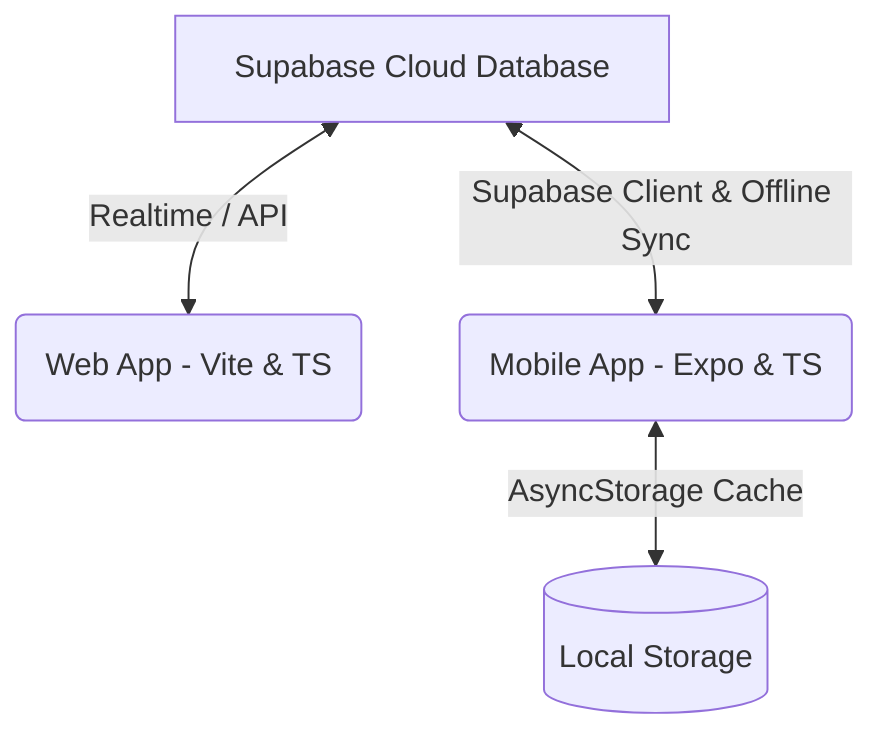

# FallTrack Production Ledger

FallTrack is a full-stack, offline-capable production tracking system designed for saree fall manufacturing and daily ledger logging. It consists of a web dashboard for administrative tracking and a mobile app for daily production logs.

## System Architecture



- **Web Dashboard**: Built with **React, TypeScript, Vite, TailwindCSS, and Recharts**. Used by managers to review statistics, manage billing cycles, adjust rates, and export reports to PDF/CSV.
- **Mobile Application**: Built with **Expo, React Native, TypeScript, and Lucide Icons**. Features complete offline support, automatic local caching, and background sync to Supabase when internet becomes active.
- **Database Backend**: Powered by **Supabase (PostgreSQL)** with row-level security policies (RLS).

---

## Database Schema & Normalization

The database is designed around **Third Normal Form (3NF)** principles to eliminate redundancy and maintain database integrity:

### 1. `colors`
Stores saree fall color entries. Color names are stored once.
* `id` (UUID, Primary Key)
* `name` (TEXT, Unique) — e.g., 'काळा', 'लाल'
* `created_at` (TIMESTAMP)

### 2. `rates`
Historical rate cards to track payment rates dynamically.
* `id` (UUID, Primary Key)
* `rate_per_dozen` (NUMERIC) — Rate paid per dozen falls
* `effective_from` (DATE) — Date when this rate card becomes active

### 3. `production_entries`
Daily ledger entries logged by the manager.
* `id` (UUID, Primary Key)
* `entry_date` (DATE) — Date of production log
* `color_id` (UUID, Foreign Key REFERENCES `colors.id`)
* `quantity` (INTEGER) — Number of falls logged

### 4. `income_periods`
Archived billing cycles to track payouts over time. 
* `id` (UUID, Primary Key)
* `period_name` (TEXT)
* `start_date` (DATE)
* `end_date` (DATE)
* `total_falls` (INTEGER) — Snapshot of total falls in this cycle (frozen for archive integrity)
* `total_income` (NUMERIC) — Snapshot of total payout in this cycle (frozen for archive integrity)

### 5. `profile`
System profile configuration (single-row table).
* `id` (BOOLEAN, Primary Key, Constrained to `TRUE`)
* `app_name` (TEXT)
* `manager_name` (TEXT)
* `manager_phone` (TEXT)

---

## Web Dashboard Setup & Development

The web dashboard is located in the root directory.

### 1. Environment Configuration
Create a `.env` file in the root directory:
```env
VITE_SUPABASE_URL=https://your-supabase-project.supabase.co
VITE_SUPABASE_ANON_KEY=your-anon-public-key
```

### 2. Start Locally
```bash
# Install dependencies
npm install

# Run the local development server
npm run dev

# Compile TypeScript and build for production
npm run build
```

---

## Mobile Application Setup & Development

The mobile application is located in the `/mobile` directory.

### 1. Environment Configuration
Create a `.env` file in the `/mobile` directory:
```env
EXPO_PUBLIC_SUPABASE_URL=https://your-supabase-project.supabase.co
EXPO_PUBLIC_SUPABASE_ANON_KEY=your-anon-public-key
```

### 2. Prebuilding & Local Running
```bash
cd mobile

# Install dependencies
npm install

# Generate native Android resource folders
npx expo prebuild --platform android

# Run app locally via Expo Go server
npx expo start

# Run app locally via Expo Go server with cloud tunnel (bypasses Wi-Fi blocks)
npx expo start --tunnel
```

### 3. Compiling the Release APK
To compile the final release APK locally:
1. Open local properties in `/mobile/android/local.properties` and verify your Android SDK path:
   ```properties
   sdk.dir=C\:\\Users\\ADMIN\\AppData\\Local\\Android\\Sdk
   ```
2. Run the Gradle build command inside the android folder:
   ```bash
   cd mobile/android
   ./gradlew assembleRelease
   ```
3. Your compiled APK will be generated at:
   `/mobile/android/app/build/outputs/apk/release/app-release.apk`

---

## Production Data Reset Guide

When you are ready to transition from testing to actual production use, you can clear all test records by running these commands inside your **Supabase Dashboard SQL Editor**:

```sql
-- 1. Empty the test daily logs
TRUNCATE TABLE production_entries CASCADE;

-- 2. Empty the test payment/billing periods
TRUNCATE TABLE income_periods CASCADE;

-- 3. Empty the rates table (if you want to re-define your rate history)
TRUNCATE TABLE rates CASCADE;
```

*To wipe the local cache of old test records from mobile phones, simply uninstall the app and install the fresh APK, or Log Out and Log In again via the Settings screen.*
